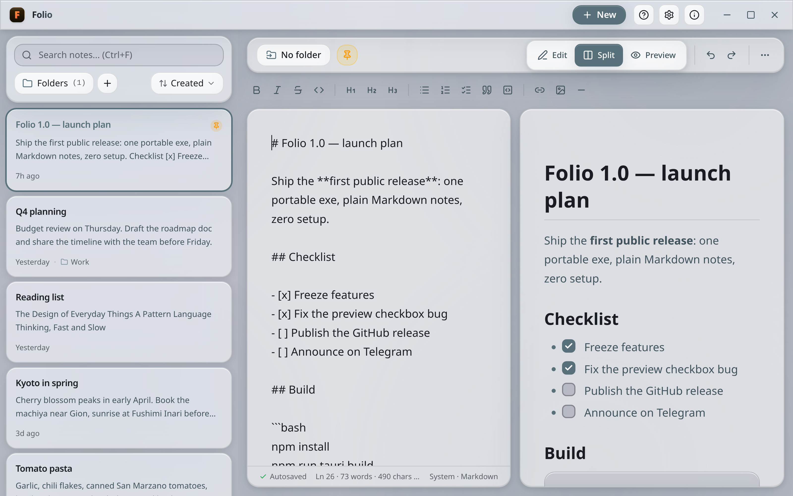
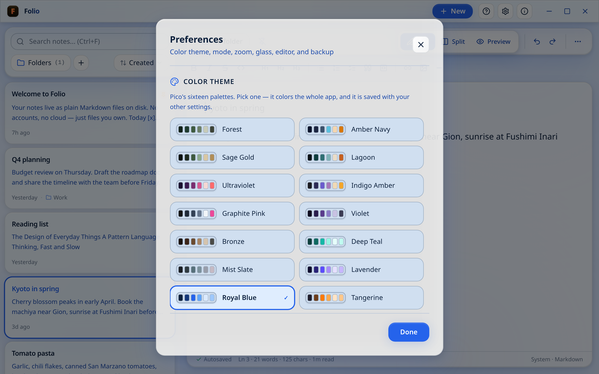

<p align="center">
  
</p>

<h1 align="center">Folio</h1>

<p align="center">
  A small, fast, portable notes app for Windows.<br>
  Notes are plain Markdown files on disk — no accounts, no cloud, no lock-in.<br>
  If the app ever goes away, your notes stay readable.
</p>

<p align="center">
  <a href="https://github.com/iK4w4/Folio/releases"></a>
  
  
  
  
</p>

<p align="center">
  <a href="https://www.youtube.com/@iK4w4"></a>
  <a href="https://t.me/iK4w4"></a>
  <a href="https://t.me/AskKawaBot"></a>
</p>

## Screenshots


*Light mode — Mist Slate, Split view with live preview*


*Light mode — Royal Blue, Preferences with the sixteen palettes*

## Download

Grab `Folio.exe` from the [Releases](https://github.com/iK4w4/Folio/releases) page. One portable file — drop it in any folder or on a USB drive and run it. Everything it needs lives next to the exe.


## Features

- **No titles.** A note has no title field — the first line *is* the note. Files are named from the date, a slug of the first words (Persian, Arabic, Cyrillic, CJK, and Latin all work), and a random suffix so names never collide.
- **Instant autosave.** 500 ms after every keystroke, flushed immediately on blur, note switch, or window close — the last keystrokes are never dropped.
- **Undo/redo that survives autosave.** Typing bursts coalesce into one undo step, and saving never resets the stack.
- **Folders.** Real subdirectories under `Notes/`. Drag a note onto a folder to move it.
- **One way per action.** Pin, move, duplicate, export, and trash live in the note's right-click menu and the editor's "⋯" menu.
- **Search & sort.** Live search over the first line and body. Sort by Created, Newest, Oldest, or A–Z.
- **One backup file.** `All Notes.txt` lives next to the exe, rewritten atomically after every change. "Restore Missing from Backup" re-imports notes that are gone from disk without overwriting anything that exists.
- **Liquid glass & themes.** Dark (default) and Light mode, sixteen color palettes, zoom 90–150%.
- **Formatting toolbar.** Bold, italic, strikethrough, code, headings, lists, quote, code block, link, image, divider — Ctrl+B/I/K included.
- **Single instance.** Launching Folio again focuses the running window instead of opening a second copy that could overwrite your notes.
- **100% offline & private.** No accounts, no cloud, no tracking, no network calls.

## Where your data lives

Everything sits next to the exe — the app is fully portable:

```
Folio.exe
Notes/            <- your notes, plain .md files, folders as subdirectories
settings.json     <- theme, palette, zoom, font, glassiness
pins.json         <- pinned notes
folders.json      <- folder registry
trash.json        <- trash registry
Trash/            <- soft-deleted notes (restorable)
All Notes.txt     <- the whole collection, rewritten after every change
```

## Build from source

Prerequisites: Node.js 18+, the Rust toolchain (stable, MSVC), and WebView2 (preinstalled on Windows 10/11).

```bash
npm install
npm run tauri build
```

Or step by step:

```bash
npm install
npm run build        # frontend -> dist/
cd src-tauri
cargo build --release
```

Output: `src-tauri/target/release/folio.exe`. Cross-compiling from Linux works with `cargo-xwin`: `cargo xwin build --release --target x86_64-pc-windows-msvc`.

## Security

Folio is fully offline and stores everything as plain files you own. See [SECURITY.md](SECURITY.md) for how to report a vulnerability.

## Credits

Created by **iK4w4**
Support: [Telegram @AskKawaBot](https://t.me/AskKawaBot)
