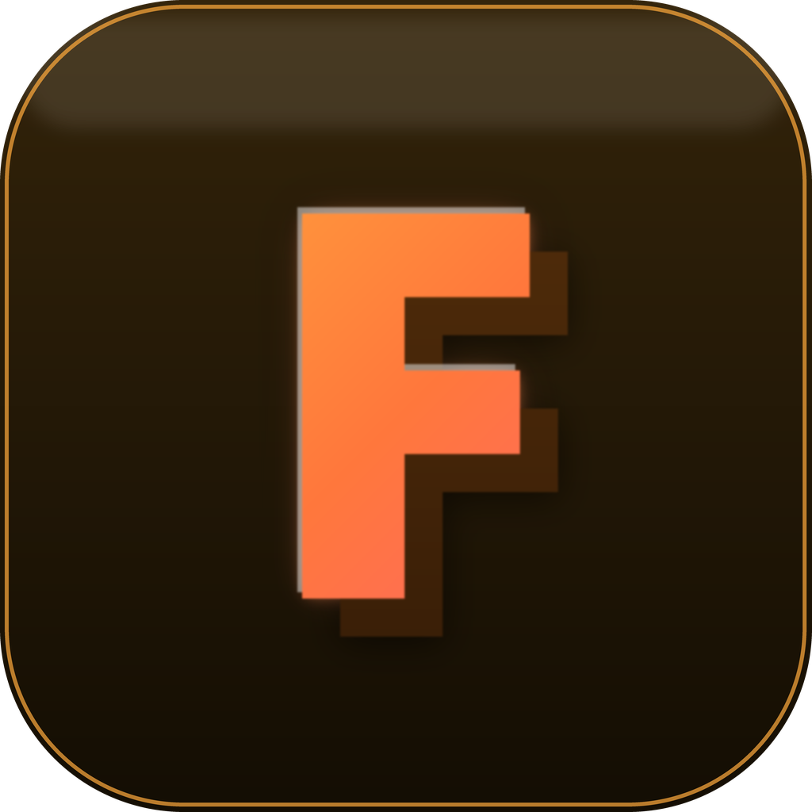

<p align="center">
  
</p>

<h1 align="center">Folio</h1>

<p align="center">
  A small, fast, portable notes app for Windows.<br>
  Notes are plain Markdown files on disk — no accounts, no cloud, no lock-in.<br>
  If the app ever goes away, your notes stay readable.
</p>

<p align="center">
  <a href="https://github.com/iK4w4/Folio/releases"></a>
  
  
  
  
  <a href="https://github.com/iK4w4/Folio/actions/workflows/ci.yml"></a>
</p>

<p align="center">
  <a href="https://www.youtube.com/@iK4w4"></a>
  <a href="https://t.me/iK4w4"></a>
  <a href="https://t.me/AskKawaBot"></a>
</p>

## Screenshots


*Light mode — Mist Slate, Split view with live preview*


*Light mode — Royal Blue, Preferences with the sixteen palettes*

## Download

Get `Folio.exe` from the [Releases](https://github.com/iK4w4/Folio/releases)
page and run it. One portable file — drop it in any folder or on a
USB drive. Everything it needs lives next to the exe.

## Features

| | |
|---|---|
| **No titles** | The first line *is* the note — files are named from the date and first words (Persian, Arabic, Cyrillic, CJK, and Latin all work) |
| **Instant autosave** | Saves 500 ms after every keystroke, and right away on note switch or window close |
| **Undo that lasts** | Undo/redo survives autosave — saving never resets the stack |
| **Folders** | Real subfolders under `Notes/` — drag a note onto a folder to move it |
| **Right-click actions** | Pin, move, duplicate, export, and trash, all in the note's menu |
| **Search & sort** | Live search over title and body; sort by Created, Newest, Oldest, or A–Z |
| **Backup file** | `All Notes.txt` next to the exe holds the whole collection, rewritten after every change — the previous copy is kept as `All Notes.previous.txt` |
| **Themes** | Dark and Light mode, sixteen color palettes, zoom 90–150% |
| **Formatting toolbar** | Bold, italic, code, headings, lists, quote, link, image, divider |
| **Single instance** | Opening Folio again focuses the running window instead of a second copy |
| **Fully offline** | No accounts, no cloud, no tracking, no network calls |

## Where your data lives

Everything sits next to the exe — the app is fully portable:

```
Folio.exe
Notes/            your notes, plain .md files (folders are subfolders)
settings.json     theme, palette, zoom, font
pins.json         pinned notes
folders.json      folder list
trash.json        trash list
Trash/            deleted notes (restorable)
All Notes.txt     the whole collection, as one backup file
All Notes.previous.txt  the previous backup, kept in case the newest is lost
```

The Export button also copies `All Notes.txt` to a `Folio` folder in your Documents, so a copy survives outside the app folder.

## Build from source

You need Node.js 18+, Rust (stable, MSVC), and WebView2
(preinstalled on Windows 10/11).

```bash
npm install
npm run tauri build
```

Output: `src-tauri/target/release/folio.exe`. Cross-compiling from
Linux works with `cargo-xwin`: `cargo xwin build --release --target x86_64-pc-windows-msvc`.

## Security

Folio is fully offline and stores everything as plain files you
own. See [SECURITY.md](SECURITY.md) for how to report a vulnerability.

**Plain files means no encryption.** Your notes are readable by
anyone who can open the Folio folder — there is no password or lock.
Don't keep secrets in Folio unless the folder itself is protected
(a private user account, an encrypted drive).

**The backup lives in the same folder.** `All Notes.txt` (and its
previous copy) protect you against a bad save or a deleted note,
not against losing the folder or the disk. Copy the folder — or use
Settings → Export — to keep a second copy somewhere else.

Each note is capped at 4 MB of text, which is far beyond any real
note.

## Credits

Created by **iK4w4** —
[GitHub](https://github.com/iK4w4) ·
[YouTube](https://www.youtube.com/@iK4w4) ·
Telegram [@AskKawaBot](https://t.me/AskKawaBot)

## License

MIT — see [LICENSE](LICENSE).
